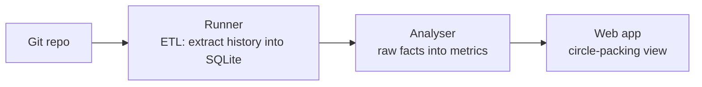

# Git Hotspot Analyzer

[](https://github.com/wheredoipressnow/hotspot/actions/workflows/ci.yml)

Analyzes a Git repository's history to surface the files that change most
(hotspots) and shows them as an interactive circle-packing visualization.

## Architecture



## Running it

The mix project is in `hotspot_umbrella/`, so run these from there:

```sh
mix setup
mix phx.server
```

Open [localhost:4000](http://localhost:4000) and pick a repository to extract and
view. A repository can also be extracted from the command line:

```sh
mix hotspot.extract [REPO_PATH]
```

Run `mix help hotspot.extract` for its options.

Databases are written one per repository under `HOTSPOT_DB_DIR`. When that
variable is unset, the location defaults to `$XDG_DATA_HOME/hotspot`, or
`~/.local/share/hotspot` when `XDG_DATA_HOME` is also unset.

## License

[MIT](./LICENSE)
